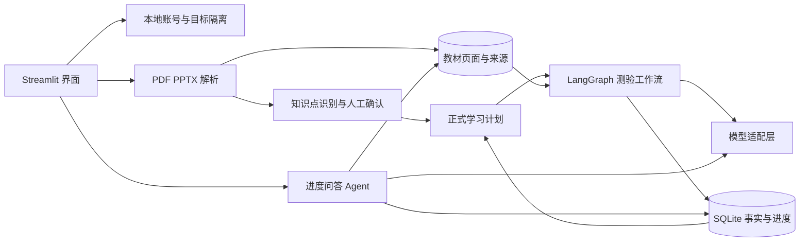

# Study Coach 项目总体设计

## 1 项目定位

Study Coach 是一个以学习目标为中心的 AI 学习教练。它不是普通聊天机器人，也不是把教材直接交给模型总结，而是把学习过程组织成一个可追踪的闭环：用户建立目标，上传教材，确认知识点，按知识点学习和测验，系统依据教材给出逐题反馈，并把结果沉淀为后续计划和进度依据。

当前版本面向个人学习和课程演示，重点验证三件事：测验是否真正基于教材，学习进度是否围绕目标持续更新，模型结论是否能追溯到记录和教材页码。

从产品形态看，它处在传统 LMS（学习管理系统）与通用 AI Tutor 之间：LMS 擅长保存课程和成绩，但通常不会根据个人薄弱点动态调整；通用聊天模型能解释知识，却容易脱离教材，也缺少稳定的长期状态。Study Coach 的目标是把两者连接起来——用数据库保存确定事实，用教材限定知识边界，再让模型完成知识识别、出题、解释和形成性反馈。

## 2 产品需求

### 2.1 核心用户需求

- 一个账号可以建立多个学习目标，每个目标有周期、每周投入时间和主题。
- PDF 和 PPTX 教材必须绑定具体学习目标，并支持一次上传多份。
- 系统从教材中提出候选知识点，但用户拥有最终确认权，可以编辑、删除、合并或排除知识点。
- 正式计划由确认后的知识点组成，每个知识点包含达成层级、预计学习时间、教材来源和掌握状态。
- 测验必须基于所选知识点的教材内容，保存题目、参考答案和页码来源。
- 提交后要有逐题点评，而不只是总分；测验结果要更新知识点掌握度和下一步建议。
- 进度问答必须读取当前目标的真实记录和教材，显示实际使用的来源。
- 用户可以切换或删除目标，数据不能串到其他账号或其他目标。

### 2.2 当前非目标

当前版本不把模型评分视为正式考试成绩，也没有完整 OCR、向量数据库、多 Agent 协作、云端高可用认证和生产级权限体系。它首先解决单机 MVP 中的学习闭环、事实存储和可解释性问题。

### 2.3 产品设计原则

- **目标隔离**：教材、知识点、测验、进度都必须属于明确的用户和学习目标，不能依赖页面当前状态猜测归属。
- **证据优先**：涉及教材内容时，先检索教材证据，再调用模型；没有足够证据时明确提示。
- **人在回路中**：模型提出候选知识结构，用户确认最终计划，避免一次识别错误持续影响后续学习。
- **进度围绕知识而不是文件**：新教材应补充知识点和证据，而不是清空已有掌握度。
- **确定逻辑与生成能力分离**：权限、状态和数据写入由程序控制；出题、解释等语言任务交给模型。
- **事实与语义记忆分离**：业务事实必须可查询、修改、删除和审计；语义召回只是增强层。

## 3 总体架构



系统分为五层：

1. **交互层**：Streamlit 提供登录、目标、教材、测验、进度问答和记忆管理页面。
2. **工作流层**：LangGraph 管理出题和评分两个确定阶段，保证评分使用原题。
3. **Agent 层**：进度问答由单 Agent 选择只读工具，按需读取档案、学习记录、统计或教材。
4. **Memory 与知识层**：SQLite 保存用户事实、目标、知识点、测验、学习事件和教材页；上传文件保存在本地目录。
5. **模型层**：统一适配在线模型和离线演示模式，业务代码不直接散落模型配置。

### 3.1 模块职责与边界

| 模块 | 主要职责 | 不负责什么 |
|---|---|---|
| Streamlit UI | 接收输入、展示状态、组织页面流程 | 不作为长期数据源，不直接决定掌握度 |
| AuthStore / StudyStore | 用户认证、目标隔离、事务化保存业务事实 | 不调用模型推断事实 |
| Material Service | 解析 PDF/PPTX，保存页面文本与来源 | 不直接把候选结果变成正式计划 |
| Course Planning | 候选知识点、人工确认、合并和计划排序 | 不覆盖历史掌握记录 |
| LangGraph Workflow | 编排出题与评价阶段，传递受约束状态 | 不承担数据库和权限职责 |
| Progress Agent | 根据问题选择只读工具并组织回答 | 不直接修改成绩、目标或教材 |
| Model Adapter | 统一模型配置、结构化调用、在线与 demo 切换 | 不保存业务状态 |
| SQLite Memory | 保存可审计事实、状态和教材索引 | 不替代语义理解和内容生成 |

## 4 技术选型与选择原因

| 技术 | 在项目中的用途 | 选择原因 | 已知代价与升级方向 |
|---|---|---|---|
| **Streamlit** | 登录、目标管理、教材上传、知识点确认、学习与测验、进度问答 | Python 原生，能快速把数据与模型流程做成可交互 MVP，适合课程展示与快速迭代 | 复杂前端状态、精细路由和多人高并发能力有限；产品化时可拆为 React/Next.js 前端与 FastAPI 后端 |
| **LangGraph** | 编排 generate 与 evaluate 等有状态阶段 | 显式定义节点、边和状态，适合保证“评价必须使用已保存原题”等业务不变量；未来可加入审核、重试和人工确认节点 | 当前流程很短，纯 Python 也能实现；保留它是为了让状态边界可见，而不是增加框架复杂度 |
| **OpenAI Python SDK** | 结构化出题、逐题评价、工具调用和进度回答 | 官方客户端对超时、错误类型、结构化响应和工具调用支持稳定；调用集中在适配层，便于换模型或网关 | 依赖额度、网络和密钥；应增加成本预算、重试、请求日志和供应商降级策略 |
| **Pydantic** | 校验模型返回的题目、参考答案、来源和评分 | LLM 输出不可靠，Schema 校验可把字段缺失、类型错误和越界分数挡在数据库之前，也让模块接口更清晰 | Schema 变化需要版本兼容；后续保存 prompt/schema 版本并支持数据迁移 |
| **SQLite** | 保存用户、目标、知识点、教材页面、测验、学习记录和掌握状态 | 单文件、零运维、支持事务，适合本机 MVP；比隐式记忆更容易查询、修改、删除、测试和审计 | 不适合多实例高并发；部署版应迁移 PostgreSQL，并用对象存储保存原文件 |
| **pypdf** | 按页提取文本型 PDF | 依赖轻、能保留页码映射，便于引用和出题取证 | 扫描件和复杂排版提取较差；后续加入 OCR、版面分析及表格/公式识别 |
| **python-pptx** | 提取 PPTX 每页文本与标题 | 可直接读取 slide 和 shape，天然保留幻灯片页码，适合课程材料 | 对图片内文字、动画和图表语义支持有限；需要 OCR 或多模态模型补充 |
| **关键词检索** | 检索当前目标中与知识点相关的教材页面 | 实现简单、结果可解释、页码稳定，适合小规模 MVP，也便于调试题目用了什么证据 | 同义词和跨段语义召回有限；数据增长后升级为关键词 + 向量混合检索，再加入 reranker 和引用校验 |
| **scrypt + 随机盐** | 本地账号密码哈希 | 内存困难型密码派生方法，优于明文或普通哈希；无需外部服务即可验证本地多用户隔离 | 当前仍是本地认证；公网部署应接入支持找回密码、MFA 和安全会话的成熟身份服务 |
| **python-dotenv / Settings** | 管理 API Key、模型名、Base URL 和运行模式 | 把密钥与代码分离，并在一个入口完成配置校验，避免判断逻辑散落 | .env 只适合本地开发；部署时应使用 Secret Manager，并禁止密钥进入日志和仓库 |
| **Python 3.11–3.13** | 承载 UI、解析、工作流、模型和数据服务 | 项目主要库均有成熟 Python 接口，同一语言贯穿原型可减少前后端胶水代码；版本范围与 pyproject.toml 一致 | 高并发服务和重型文档任务后续可拆成独立 worker；升级 Python 前需跑完整测试 |
| **setuptools** | 构建 study-coach-course Python 项目 | 标准、简单，当前项目只有一组顶层模块，不需要更复杂的 monorepo 构建系统 | 模块继续增多时应改为 src/package 目录结构并明确公共接口 |
| **uv + uv.lock** | Python 环境、依赖安装和版本锁定 | 安装速度快，锁文件让开发、测试和演示使用相同依赖，减少环境差异 | 依赖升级仍需主动测试；生产环境还应固定 Python 版本并做漏洞扫描 |
| **unittest + Streamlit AppTest** | 验证存储、工作流、模型边界和关键页面行为 | unittest 无额外依赖；AppTest 能覆盖 Streamlit rerun/session state 等函数测试看不到的问题 | 后续还要增加真实教材、真实模型集成测试和专门的 AI 质量评估集 |

这些技术不处在同一层，也不是互相替代品。LangGraph 管流程，SQLite 管事实，OpenAI SDK 管模型通信，Pydantic 管输入输出边界，检索模块管证据获取。把其中任何一个当作完整的“Agent 框架”，都会造成职责混乱。

## 5 业务闭环

```text
创建学习目标
    ↓
上传目标对应的 PDF 或 PPTX
    ↓
解析页面并生成候选知识点
    ↓
用户确认 达成标准 预计时长 合并与取舍
    ↓
形成正式计划并选择当前知识点
    ↓
基于教材页码生成题目和参考答案
    ↓
逐题评价并更新掌握状态
    ↓
优先安排需复习或尚未掌握的知识点
    ↓
进度 Agent 结合记录和教材回答下一步
```

这个闭环的关键是知识点，而不是文件。新教材如果涉及已有知识点，会补充新的来源，不会清空已完成进度；真正的新知识才进入待确认列表。目标进度只统计已确认并纳入计划的知识点。

### 5.1 为什么自动识别后还要人工确认

教材目录不一定等于合理的学习单元：同一知识可能跨多页或多份材料，标题也可能只是版式文本。模型先提出候选知识点可以降低整理成本，但直接写入正式计划会让误识别持续污染出题和进度。因此识别结果先作为草稿，用户可以改名、合并重复项、排除无关内容，并设置达成层级和预计时间，确认后才进入正式计划。

### 5.2 测验如何真正驱动进度

每次测验都绑定用户、目标、知识点、原题版本和教材来源。提交后，系统保留逐题答案，模型按参考答案和教材证据给出点评，再把逐题结果聚合为该知识点的掌握状态。后续计划优先显示“需复习”和“学习中”，完成目标放在列表下方。这样目标周期不只是展示字段，而能用于比较剩余知识量、预计时长与每周可投入时间。

## 6 Agent 与 LangGraph 框架

项目没有为了复杂而拆成多 Agent，目前只有一个适合自主决策的场景：进度问答。

进度 Agent 可以调用四类只读工具：读取学习档案、读取近期学习记录、读取主题成绩统计、检索当前目标的教材。模型决定调用哪个工具以及如何组织回答；Python 白名单负责校验工具名、参数、用户和目标范围。首次回答必须先取证，达到工具轮数上限则停止。

出题与评分不采用自由 Agent 循环，因为这两步有固定输入、输出和顺序，更适合 LangGraph 受控工作流：

```text
stage = generate  → 生成题目 → 结束
stage = evaluate  → 使用已保存原题评分 → 结束
```

这样选择的原因是：需要模型判断信息来源时使用 Agent；需要保证业务不变量时使用显式工作流。当前最重要的不变量包括评分对应原题、题目来自教材、结果属于正确用户和目标。

### 6.1 为什么选 LangGraph，而不是只用 LangChain Chain

LangChain 更像模型、Prompt、Retriever 和 Tool 的通用组件集合；LangGraph 更关注一个有状态过程如何在节点间流转、分支、暂停和恢复。本项目最重要的不是把很多组件串成一条长链，而是明确区分“生成题目”和“评价已提交答案”，并保证评价阶段不会重新生成题目，因此 LangGraph 更贴合核心问题。

这不意味着所有代码都要进入图中。文件解析、数据库 CRUD、密码校验和页面渲染仍是普通 Python 服务；只有涉及模型且需要状态约束的流程进入图。这样既利用 LangGraph 的可观察性和扩展性，也避免框架侵入整个系统。

项目当前也没有额外安装完整的 LangChain 依赖：模型通信直接使用 OpenAI SDK，数据访问使用项目自己的服务和 Tool 封装，只有状态图使用 LangGraph。这样可以减少抽象层和依赖面；将来若需要现成 Retriever、Loader 或更多供应商适配，再按明确需求引入相应 LangChain 组件。

### 6.2 为什么目前不用多 Agent

当前没有多个需要独立长期上下文、相互协商的角色。强行拆成“规划 Agent、出题 Agent、评分 Agent、记忆 Agent”会增加调用次数、上下文复制、错误传播和调试成本，却不会自动提高教材忠实度。因此当前采用“一个进度 Agent + 若干受控工作流”。只有在课程研究、多评价者或规划任务确实需要独立上下文和并行工作时，才考虑多 Agent。

### 6.3 Tool 的安全边界

Agent 工具默认只读，每次查询都必须携带服务端确认的 user_id 和 goal_id。模型可以建议调用哪个工具，但不能自己拼 SQL、修改成绩或跨目标搜索。工具输出限制长度并保留来源 ID，从而降低 prompt injection、隐私串线和超长上下文风险。

## 7 Memory 框架

当前版本不再把 Memori 当作事实数据库，而是采用显式 SQLite Memory。数据按用途分层：

| 层级 | 保存内容 | 设计原因 |
|---|---|---|
| 身份与目标 | 用户、目标、周期、偏好 | 必须由用户确认，不能靠模型猜测 |
| 知识结构 | 知识点、层级、预计时长、教材页码 | 支撑计划、测验和进度计算 |
| 工作状态 | draft、submitted、graded 测验 | 页面刷新后仍能恢复，避免重复评分 |
| 情景记录 | 学习主题、答案、反馈、模型和时间 | 保留真实学习历史并可追溯 |
| 掌握状态 | 未开始、学习中、需复习、基本掌握、已掌握 | 将测验结果转换为下一步计划 |
| 教材知识 | 文件、页面文本、标题、备注和来源 | 为出题与问答提供证据 |

选择显式存储而不是完全依赖 Memori，主要因为目标、原题、答案、成绩和完成状态都是业务事实，必须可检查、可修改、可删除并具备确定的数据边界。Memori 或向量记忆以后可以作为语义召回层加入，但不应该替代事实表。

教材检索目前使用可解释的关键词匹配，适合 MVP 和页码追踪，但还不是完整向量 RAG。后续升级应保留原始页码来源，再增加 embedding、重排序和引用校验。

### 7.1 为什么显式 Memory 比原来的 Memori 更合适

Memori 一类组件擅长从对话中抽取偏好和柔性事实，例如“用户喜欢先看例子”；但本项目的核心数据是目标周期、知识点、原题、答案、分数和完成状态。这些字段需要事务、一致性、外键隔离、删除和审计，不能依赖模型从对话中重新推断。

因此这里不是简单地“把 Memori 换成另一个记忆库”，而是重新划分职责：

- SQLite 是业务事实的唯一真相来源；
- 教材页库是外部知识和引用来源；
- Agent 对话摘要、向量数据库或 Memori 可以作为可选的语义召回层；
- LangGraph checkpoint 可以恢复工作流，但不能替代业务表。

未来即使加入 Memori 或向量记忆，它们也只能增强召回，不能成为成绩和计划的唯一数据源。

### 7.2 Memory 的写入与读取策略

- 用户明确输入的目标、周期、偏好和资料归属，经校验后直接写入。
- 模型识别出的知识点先写为候选状态，用户确认后才进入正式计划。
- 测验生成时保存题目、参考答案、来源和模型版本；评价只能读取这份快照。
- 进度由已保存的作答结果按规则计算，不由聊天模型凭印象宣布完成。
- Agent 回答前按需读取最小范围数据，并把使用的记录或教材来源展示给用户。

### 7.3 为什么教材知识与个人记忆分开

教材属于某个目标的外部证据，个人记忆属于某个用户的学习经历和掌握状态。两者生命周期、权限和更新方式不同。分开后，同一知识点可以追加新教材来源而不覆盖进度；删除一份材料时也能精确判断哪些引用受影响，而不必删除整个学习历史。

## 8 检索与教材处理

当前系统采用标题加权的关键词匹配。选择它作为 MVP，并不是认为它永远优于向量检索，而是因为当前教材规模较小，页码可解释性比模糊语义召回更重要。它可以明确显示“题目用了哪个文件的哪一页”，也便于定位错误来源。

下一阶段的 RAG 应采用混合检索：

1. 先按用户和学习目标做权限过滤；
2. 关键词检索保证术语精确匹配；
3. Embedding 召回同义表达与跨段语义；
4. Reranker 对候选页面重新排序；
5. 模型只基于最终证据生成；
6. 对答案中的引用做存在性和支持度校验。

向量数据库只解决“召回相近内容”，不会自动保证引用真实、答案正确或用户隔离，所以它不能替代页码元数据、权限过滤和引用验证。

## 9 模型选择与上下文工程

模型不是写死在架构中的。当前本地在线配置使用 `gpt-4.1-mini`，示例配置使用 `gpt-4o-mini`，也可以通过模型适配层替换兼容服务。选择 mini 级模型是因为当前任务以结构化出题、逐题评价和工具调用为主，需要在中文能力、JSON 稳定性、延迟和成本之间取得平衡，而不是追求最大模型的通用推理上限。

选择模型时按以下顺序验证：

1. 能否稳定输出符合 Pydantic 约束的 JSON。
2. 能否正确执行工具调用并遵守只读边界。
3. 能否依据教材证据生成问题、参考答案和来源。
4. 同一量表下的评分是否基本一致。
5. 延迟、失败率和调用成本是否适合高频学习场景。

离线 demo 模式只用于验证流程和界面，不产生真实评分。在线模型反馈属于形成性建议，仍需通过专门评估集检查题目相关性、引用准确性和评分稳定性。

### 9.1 为什么当前项目使用 gpt-4.1-mini

系统的高频任务不是开放式创作，而是阅读有限教材片段、遵守 JSON Schema、生成少量题目、调用工具和给出逐题解释。mini 级模型在中文能力、结构化输出、延迟和成本之间较平衡，使同一知识点可以进行多轮练习。

当前代码选择 gpt-4.1-mini 还有两个直接原因：它支持 function calling 和 Structured Outputs，适合进度 Agent 的工具调用与测验 JSON；同时它是非推理型 mini 模型，交互延迟较低。OpenAI 官方模型页目前已把该型号标记为 deprecated，并建议复杂的新任务优先从更新的 mini 型号开始，因此它应被视为“现有 MVP 的兼容默认值”，而不是长期写死的最佳选择。

更强模型可作为复杂公式、困难教材或低置信度结果的升级通道，而不必让所有请求承担最高成本。gpt-4o-mini 保留在示例配置中，方便兼容和低成本实验。下一轮应把当前模型与更新的 mini 型号放进同一评估集，而不是直接凭型号迁移；样本至少覆盖中英文教材、长页面、来源不足、工具失败和恶意教材指令。

### 9.2 为什么保留模型适配层和 Base URL

网络环境、组织网关和模型策略可能变化。适配层统一处理模型名、API Key、Base URL、超时、重试和异常映射，避免 UI、Agent 与图节点分别创建客户端。Base URL 必须包含完整的 http:// 或 https://；网络故障、额度不足、模型无权限和 JSON 校验失败应给出不同诊断，同时不能泄露密钥或完整请求。

### 9.3 上下文如何控制

模型不会收到整个数据库或整本教材。系统根据当前用户、目标与知识点，检索少量相关页面，再加入任务说明、输出 Schema 和必要学习记录。这样可以减少 token 成本、无关内容和跨目标泄漏。

教材文本被当作证据，而不是系统指令；即使材料中出现“忽略之前要求”等文字，也不能获得工具权限或改变评分规则。模型结果必须经过 Pydantic 与业务规则双重校验后才能保存。

模型能力与接口说明以 [GPT-4.1 mini 模型页](https://developers.openai.com/api/docs/models/gpt-4.1-mini)、[Structured Outputs](https://developers.openai.com/api/docs/guides/structured-outputs) 和 [Function calling](https://developers.openai.com/api/docs/guides/function-calling) 为准。模型状态、价格和可用性可能变化，因此不在业务代码中硬编码这些判断。

## 10 交互、认证、配置与可靠性设计

### 10.1 为什么先用 Streamlit

当前阶段最需要验证的是学习闭环，而不是前端工程规模。Streamlit 能让同一套 Python 对象直接用于表单、上传、图表和模型流程，开发速度高，也便于课程展示。针对它“每次交互都会 rerun”的特点，长期状态放进 SQLite，session_state 只保存当前页面选择和未提交输入；创建、删除等操作使用稳定 widget key 和回调，避免重复执行与状态覆盖。

### 10.2 登录与数据隔离

正式登录已经进入 MVP，但它是本地账号系统，不等于互联网生产认证。密码使用 scrypt 加盐哈希，用户 ID 由服务端生成；所有目标、教材、知识点、测验和工具查询都应检查用户归属。若部署到公网，应把认证交给支持安全 Cookie、邮箱验证、密码找回、速率限制与 MFA 的成熟服务，而不是继续扩写自制登录。

### 10.3 配置、依赖与可复现性

.env 只承载本地秘密和环境差异，.env.example 只展示无密钥模板；Settings 在启动时校验 online/demo 模式、模型名和 URL。pyproject.toml 描述直接依赖，uv.lock 固定完整依赖图。这样开发、测试和演示可以重建相同环境，也能明确区分“代码故障”和“配置、额度或网络故障”。

### 10.4 测试策略

- 传统单元测试验证数据库隔离、知识点合并、状态迁移、来源保存和模型输出校验。
- Streamlit AppTest 验证页面 rerun、widget key、目标切换和表单行为。
- 大多数自动测试使用可控模型替身，避免网络与模型随机性影响结果。
- 少量在线集成测试检查 SDK、模型权限、结构化输出和真实调用。
- 专门的 AI 评估集判断题目相关性、引用准确性和评分稳定性。

“代码测试通过”只能说明程序按预期运行，不能直接证明教学效果；最终仍需人工标注样本和学习结果指标。

## 11 相对原版/课程版的主要改变

| 方面 | 原版或早期课程版 | 当前版本的提升 |
|---|---|---|
| 身份 | 手动编号或弱隔离 | 本地注册登录，服务端生成用户 ID |
| 学习目标 | 单一档案目标 | 多目标并存、切换、独立进度和删除 |
| 教材 | 无教材管线 | 批量 PDF/PPTX 解析、目标绑定和页码来源 |
| 课程结构 | 主题或按文件拆章节 | 以知识点为中心，先识别再由用户确认 |
| 新教材 | 可能追加或重排章节 | 合并到已有知识点，保留已学进度 |
| 测验 | 依据主题生成通用题 | 必须选择已确认知识点并读取教材证据 |
| 反馈 | 总分和总评 | 逐题掌握度、参考答案、点评和教材来源 |
| 进度 | 记录次数和主题统计 | 知识点掌握状态、目标完成度和下一步建议 |
| Memory | Memori 隐式提取与召回 | SQLite 保存确定事实，语义增强与事实存储分离 |
| LangGraph | 原版可能重新出题后评分 | generate 与 evaluate 分支，评分复用已保存原题 |
| 可恢复性 | 会话内状态为主 | attempts 持久化草稿、提交和评分状态 |
| 可解释性 | 模型回答难追踪 | 工具轨迹、记录 ID、教材文件与页码来源 |

总体上，项目已经从“记录一次学习并让模型评价”升级为“围绕多个目标组织教材、知识点、测验和掌握度的学习闭环”。提升重点不是增加更多 Agent，而是让每一步都有明确输入、事实来源、状态变化和可验证结果。

## 12 当前边界与下一步

当前实现适合本机个人使用和课程展示。若进入真实多人部署，建议按以下顺序升级：

1. PostgreSQL、对象存储、数据库迁移和备份恢复；
2. 正式身份服务、角色权限和审计日志；
3. 扫描 PDF OCR、版面分析及 PPT 图片理解；
4. 混合 RAG、重排序、引用支持度校验和教材版本管理；
5. 模型质量评估、成本与延迟监控、重试和降级；
6. 自适应测验难度、间隔复习和更可靠的掌握度模型；
7. 当业务确有独立角色和并行任务时，再评估多 Agent。

项目是否有效，最终应由四类指标判断：知识点识别是否准确，题目是否被教材证据支持，逐题反馈是否稳定，学习者是否能更快达到目标。框架数量不是主要指标，业务闭环的可靠性才是。
