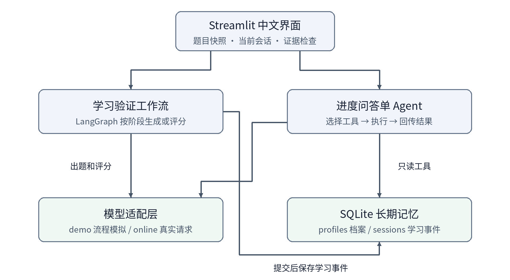
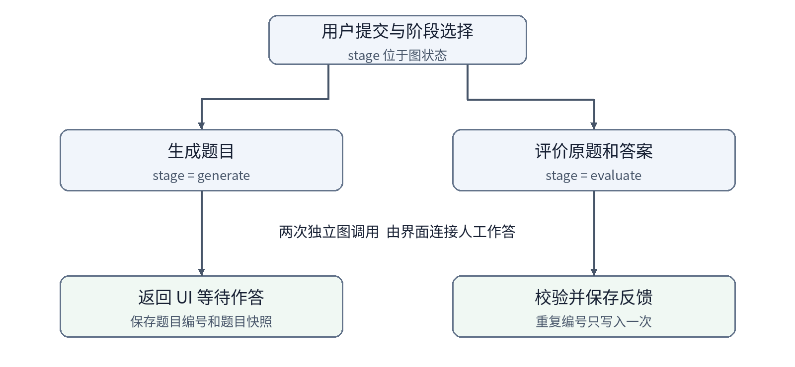
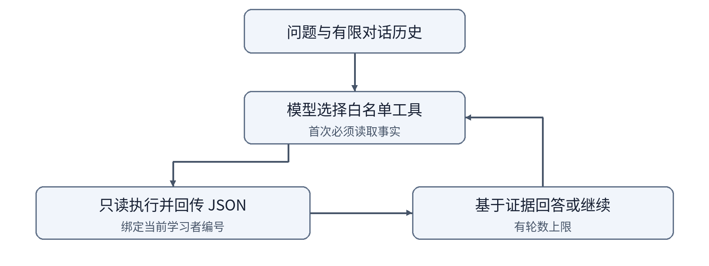

# 学习教练 Agent 课堂板书

课堂版用于提示讲解顺序。完整配置和实验细节在根目录 README。

## 开场 场景和边界

学员A学习了 Memory，但不知道自己是否理解。应用记录目标，生成练习，评价原题，再把反馈带到下一次讨论。

- 学习验证是工作流，进度问答是工具型单 Agent。
- 当前没有教材 RAG；SQLite 显式保存档案和事件。
- 原版 Memori 代码保留研究对照；演示模式不调用真实模型。

## 第一段 执行路径

不变量：评分必须使用学员看到的同一份题目。

这是两次图调用，由界面保存人工作答阶段的题目快照，不是已经实现 LangGraph checkpoint 或 interrupt。

追问：评分前又生成一份题目，会导致什么问题？

代码定位：`study_graph.py` 条件边；`app.py` 的 `attempt`。

## 第二段 Memory

| 信息 | 概念映射 | 位置 |
|---|---|---|
| 当前题目和对话 | 工作记忆 | session_state |
| 目标和偏好 | 语义记忆的一种简化应用 | profiles |
| 一次学习的过程 | 情景记忆 | sessions |
| 图像或音频 | 感知记忆 | 未实现 |

写入：确认档案后直接保存；完成练习后保存原始答案和模型反馈。

读取：绑定当前编号，查少量相关事实，再交给模型组织回答。

追问：模型回复记住了，如何验证真的持久化？为什么档案恢复不能靠模型猜测？

## 第三段 上下文和工具

用 Hello-Agents 的 GSSC 思路对照：收集信息、选择来源、分角色组织、限制或压缩。课程版只实现轻量限制，并非使用其 ContextBuilder。

- 三个只读工具：get_profile、get_recent_sessions、get_topic_stats。
- 近期历史最多带六条消息，近期记录默认六条，模型回合默认最多四轮。
- 编号过滤不是身份认证，不能直接对公网承载真实用户。

追问：一条较早但相关的学习记录被漏掉，应改哪一层？

## 第四段 演示与验收

1. 保存档案，打开记忆检查。
2. 生成练习，记录题目编号，完成作答。
3. 询问进度，展开工具与证据。
4. 刷新或重启，观察长期记忆；切换编号，检查边界。

评估：原题一致、记忆恢复、工具选择、事实支持、延迟与费用。工程测试和模型质量评估分别进行。

课后改造任选：相关性召回、评分量表、上下文预算、教材 RAG。每项交固定输入的前后对比与一个失败案例。

## 阅读链接

[上游项目](https://github.com/Arindam200/awesome-ai-apps/tree/main/memory_agents/study_coach_agent)

[Hello-Agents 第八章](https://github.com/datawhalechina/hello-agents/tree/main/docs/chapter8) · [第九章](https://github.com/datawhalechina/hello-agents/tree/main/docs/chapter9) · [第十二章](https://github.com/datawhalechina/hello-agents/tree/main/docs/chapter12)

本讲义与图示独立编写。原软件许可见根目录 LICENSE。Hello-Agents 教材当前采用 CC BY-NC-SA 4.0，直接复制或商业改编其内容需另行核实授权。
